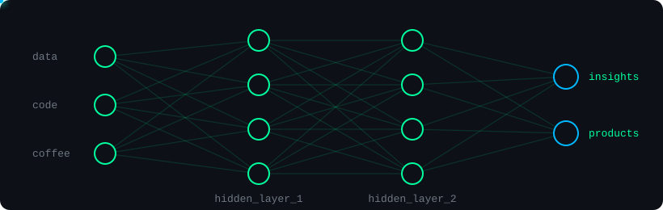

<!-- ═══════════════════════════  HEADER  ═══════════════════════════ -->
<div align="center">


<a href="https://git.io/typing-svg">
  
</a>

<br/><br/>



</div>

<p align="center"></p>

### `> whoami`

```python
class Som:
    def __init__(self):
        self.role      = "Data Science & AI/ML Engineer"
        self.education = "B.Tech CSE (AI & ML) — SRM IST, Ramapuram"
        self.exp       = "Ex-Trainee @ Mu Sigma (Microsoft WDG team)"
        self.focus     = ["Machine Learning", "Data Pipelines", "Full-Stack Dev", "Cloud (GCP)"]
        self.building  = ["Seat Booking System (PostgreSQL)", "Fleet & Logistics Dashboard"]
        self.open_to   = ["Data Scientist", "Data Analyst", "SDE", "DevOps"]

    def motto(self):
        return "Build first. Reverse-engineer the 'why' after. Repeat."

me = Som()
```

<div align="center">
  
</div>

<p align="center"></p>

### `> ls ./tech-stack`

<div align="center">

**Languages**


**Frameworks & Tools**


**Data Science & ML**


</div>

<p align="center"></p>

### `> cat ./featured-projects.md`

<table>
<tr>
<td width="50%" valign="top">

#### 🧭 [CareerLens AI](https://github.com/somsatyesh108/Job-Trend-Analyzer)
AI-driven job-market analyser & skill-gap predictor — backed by a co-authored research paper.

`XGBoost` salary prediction · `TF-IDF` job recommendations · `K-Means` clustering · `Llama3` via Groq

  

</td>
<td width="50%" valign="top">

#### 🛢️ Well Production Forecasting
Replaced manual Decline-Curve-Analysis EUR estimates with an automated ML pipeline combining well, geological, completion & production data.

`Feature engineering` · `Regression` · `Dashboarding`

  

</td>
</tr>
<tr>
<td width="50%" valign="top">

#### ⛽ BunkerSmart
Fuel-management system with role-based React dashboards — built by an 8-person team (repo owner & frontend dev).

  

</td>
<td width="50%" valign="top">

#### 🎟️ Seat Booking System &nbsp;<sub>`🚧 in progress`</sub>
Full-stack booking engine with real-time seat locking and a relational PostgreSQL backend.

 

</td>
</tr>
</table>

<p align="center"></p>

### `> git log --stats`

<div align="center">


</div>

<p align="center"></p>

### `> ./snake.exe`

<div align="center">
  <picture>
    <source media="(prefers-color-scheme: dark)" srcset="https://raw.githubusercontent.com/somsatyesh108/somsatyesh108/output/github-snake-dark.svg" />
    
  </picture>
</div>

<p align="center"></p>

### `> ping som`

<div align="center">

<a href="https://www.linkedin.com/in/YOUR-LINKEDIN/"></a>
<a href="mailto:YOUR-EMAIL@gmail.com"></a>
<a href="https://github.com/somsatyesh108"></a>

</div>


